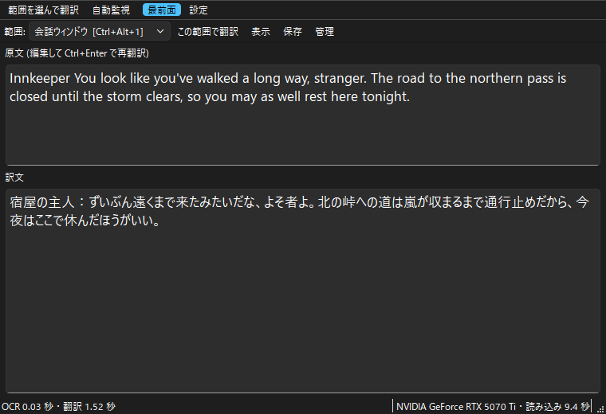
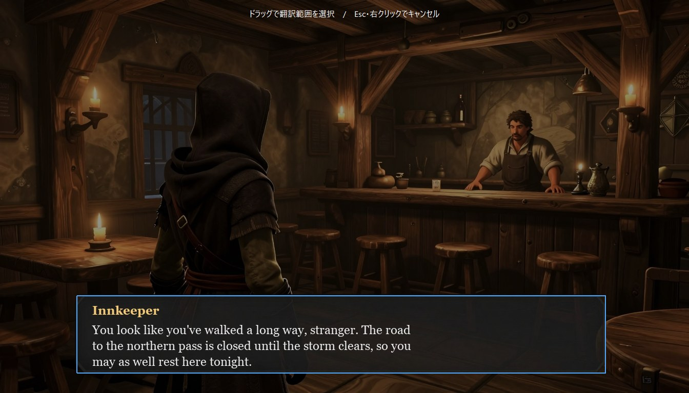
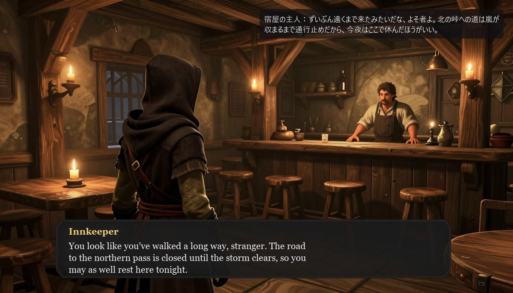

# Local Trans

PLaMo 3 Translate 0.8B（PFN）を使って、画面の英文をその場で日本語に訳すデスクトップアプリです。翻訳も OCR も PC の中だけで動き、外部 API は使いません。



## 動作環境

- Windows 10/11
- NVIDIA GPU（CUDA 12.8 対応ドライバ）推奨
- [uv](https://docs.astral.sh/uv/)

## 起動

`LocalTrans.bat` をダブルクリックします。初回は依存パッケージのインストールとモデルのダウンロード（約 1.8GB）が入ります。

デスクトップとスタートメニューにショートカットを作るときは、初回の起動が終わってから次のコマンドを実行します。ショートカットにはアプリのアイコンが付き、そこから起動したウィンドウはタスクバーにもこのアプリとしてピン留めできます。

```bash
uv run python tools/make_shortcuts.py
```

ショートカットを消すときは `--remove` を付けて実行します。

開発中は次のコマンドで動かします。

```bash
uv run python main.py
```

## 使い方

| ショートカット（既定） | 動作 |
|---|---|
| `Ctrl+Alt+Q` | 画面を止めて範囲をドラッグで選び、翻訳する |
| `Ctrl+Alt+W` | 前回と同じ範囲をキャプチャして翻訳する（選択画面は出ない） |
| `Ctrl+Alt+E` | 前回の範囲を監視して、文字が変わったら自動で翻訳する（ON/OFF） |
| `Ctrl+Alt+D` | 最小表示に切り替える（ON/OFF） |



`Ctrl+Alt+Q` を押すと画面が止まり、ドラッグで翻訳する範囲を選べます（画像のゲーム画面は説明用のサンプルです）。

- 選んだ範囲は保存され、アプリを再起動しても `Ctrl+Alt+W` や自動監視でそのまま使えます。

### 範囲プリセット

ツールバー 2 段目の「範囲:」で、よく使う範囲に名前を付けて切り替えられます（例: 会話ウィンドウ、アイテム説明）。

- 「保存」: いまの範囲に名前を付けて保存します。同じ名前なら上書きします。
- 範囲の一覧（プルダウン）: プリセットを選ぶと、それが「いまの範囲」になり、画面上に赤い枠が 1 秒ほど出ます。`Ctrl+Alt+W` と自動監視はこの範囲を使います。
- 「表示」: いまの範囲を赤枠で表示します。
- 「管理」: 名前の変更、並べ替え、削除と、プリセットごとのショートカットの設定ができます。ショートカットを押すと、ゲーム中でもその範囲に切り替えてすぐ翻訳します。

### 最小表示

ゲームに重ねて使うときは、訳文だけを半透明の帯で出す最小表示に切り替えられます。ツールバーの「最小表示」か `Ctrl+Alt+D` で切り替えます。



- 帯はドラッグで動かせます。右端をドラッグすると幅が変わり、高さは訳文の長さに合わせて変わります。
- 帯をクリックしてもフォーカスは移らないので、ゲームの操作は止まりません。
- 右クリックで出るメニューから、範囲の選択、翻訳、自動監視、設定、通常の表示に戻す操作ができます。帯をダブルクリックしても通常の表示に戻ります。
- メニューの「クリックを透過する」を選ぶと、帯の上をクリックしてもその下のゲームに届きます。透過を解除するには `Ctrl+Alt+D` を押します。
- 帯の位置と幅、最小表示を使っていたかどうかは、次に起動したときにも引き継がれます。最小表示の文字サイズと背景の濃さは設定で変えられます。

- ツールバーの「最前面」で、翻訳ウィンドウを常に前面に出すかどうかを切り替えます。
- 原文の欄は編集できます。OCR の読み間違いを直して `Ctrl+Enter` を押すと訳し直します。
- 設定では次のものを変えられます。ショートカット、文体（だ・である／です・ます）、文脈の使用（直前の文を踏まえて訳す）、実行デバイス、文字サイズ、用語集（固有名詞の訳を固定する）。

## フルスクリーンのゲームで使うとき

- キャプチャには DXGI Desktop Duplication を使います。DirectX のフルスクリーンゲームを撮っても黒くなりません。取れなかったときは GDI で撮り直します。
- ボーダーレス（仮想フルスクリーン）: 翻訳ウィンドウをゲームの上に重ねて表示できます。結果が出てもフォーカスは奪いません。
- 排他フルスクリーン: Windows の仕組み上、ほかのウィンドウをゲームの上には出せません。
  1. 最初に `Ctrl+Alt+Q` で範囲を選びます。このときゲームが一瞬最小化されることがあります。選び終わると、ゲームに自動でフォーカスが戻ります。
  2. あとは `Ctrl+Alt+W` か自動監視（`Ctrl+Alt+E`）を使います。選択画面は出ないので、ゲームは中断されません。
  3. 翻訳ウィンドウはサブモニターに置いてください。
- ショートカットは 2 通りの方法で受け取ります。1 つは通常のホットキー登録（RegisterHotKey）、もう 1 つはキーの押下状態の監視です。入力を独占するゲーム（DirectInput など）でホットキーが届かなくても、監視のほうで反応します。
- 範囲選択の画面は、ゲームが前面にあっても強制的に前に出してフォーカスを取ります。選び終わるとゲームを元に戻します。選択画面がゲームの裏に隠れて操作できなくなったときは、同じショートカットをもう一度押すと閉じます。
- ゲームを管理者権限で動かしている場合は、このアプリも管理者として起動してください。
- うまく動かないときは `local-trans.log` を見てください。ショートカットを受け取ったか（hotkey / poll）、そのとき前面にあったウィンドウ、選択画面を前に出せたかを記録しています。

## 構成

- `localtrans/capture.py`: 画面キャプチャ（dxcam → mss）
- `localtrans/ocr.py`: Windows 標準 OCR（Windows.Media.Ocr, en-US）と段落の組み立て
- `localtrans/translator.py`: PLaMo 3 Translate 0.8B（transformers, bf16, CUDA）
- `localtrans/hotkeys.py`: グローバルショートカット（RegisterHotKey＋キー状態の監視）
- `localtrans/winutil.py`: ウィンドウの前面化など Win32 の補助
- `localtrans/presets.py`: 範囲プリセットの管理と範囲の枠表示
- `localtrans/selector.py`: 範囲選択のオーバーレイ
- `localtrans/compact.py`: 最小表示の帯
- `localtrans/worker.py`: OCR と翻訳のバックグラウンド処理、自動監視
- `localtrans/window.py`: メインウィンドウ
- `tools/make_shortcuts.py`: デスクトップとスタートメニューのショートカットを作る
- 設定は `config.json`、ログは `local-trans.log` に保存します。

## ライセンス

このアプリのコードは MIT License です（[LICENSE](LICENSE)）。

モデルは PLaMo Community License で配布されています。個人・非商用での利用は無料です。商用で使う場合は、条件によっては PFN への登録が必要です。
